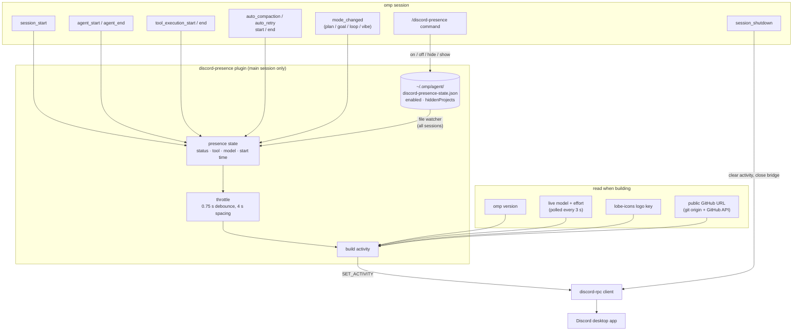
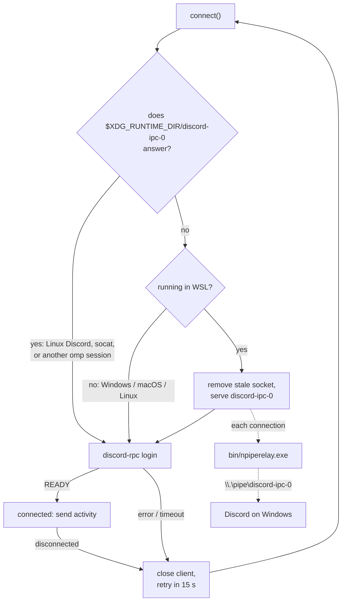
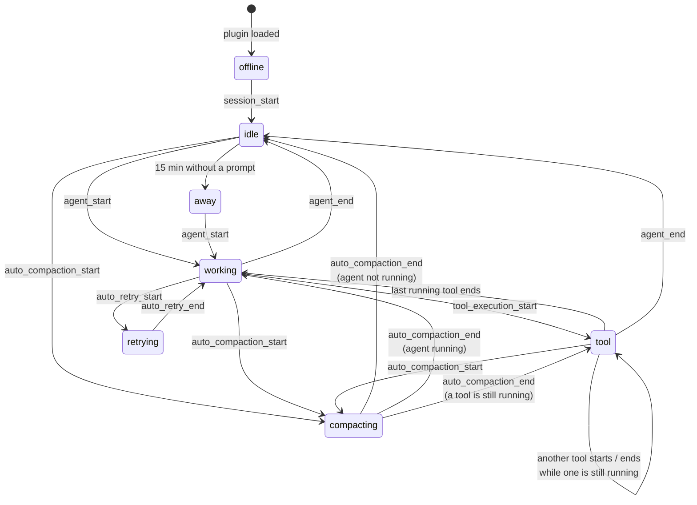

# omp-discord-presence

Discord Rich Presence extension for omp (oh-my-pi) coding agent.

Discord shows the installed omp version, the project name, any active omp mode (plan, goal, loop, vibe), the current state (idle / thinking / using tool), the active tool, the model and its effort (thinking level), with the model maker's logo as a small badge:

```text
OH MY PI
omp v18.15.0 · my-project · plan mode
using tool · bash · anthropic/claude-opus-4 · effort: high
[ View on GitHub ]
```

Status changes reach Discord within about 4 seconds. Updates are spaced out because Discord accepts only 5 activity updates per 20 seconds, and the latest state is always sent last. While tools run in parallel, the status stays on "using tool" until the last one finishes. Automatic context compaction and provider retries get their own status (`compacting context`, `retrying · attempt 2/5`). The retry's error message is never shown. The model and effort follow the selection in the omp session: a switch (`/model`, the model picker, ⇧⇥ for effort) shows within a few seconds, even without a prompt.

Active modes are joined with `+`, and paused modes get `(paused)`, e.g. `plan mode + goal mode (paused)`. Only the mode name is shown: the goal objective and the plan file path stay private.

After 15 minutes without a prompt, `idle` turns into `away`. The next prompt switches it back to `thinking`.

Context-window usage can be shown at the end of the status (`… · effort: high · context 42%`). It is **off by default**. Turn it on with `/discord-presence context on`. The value updates after every turn.

While subagents (task tool, eval agents) are working, the status shows how many are running, e.g. `using tool · wait · 2 subagents · …`. Nested subagents are included. The count drops as each one finishes.

### GitHub button

When the project is a git repository whose `origin` remote points to a **public** GitHub repo, the status gets a **View on GitHub** button linking to it.

- **When there's no button:** non-GitHub remotes, private repos and folders without git get none. Visibility is checked once per session with an anonymous GitHub API request, so a private repo's owner/name is never published.
- **Hidden projects:** `/discord-presence hide` removes the button too.
- **Your own view:** Discord never shows your own activity buttons to you. Other people see them on your profile.

Works out of the box on Windows, macOS, Linux and WSL. No Discord setup, relay, or `socat` needed on the user's side.

## Requirements

- The Discord **desktop app** running on the same machine (the browser version has no Rich Presence).
- Discord → **Settings → Activity Privacy → Share your detected activities with others** turned on.

## Install

```bash
omp install omp-discord-presence
```

Restart omp and the status appears. On WSL the bundled bridge starts by itself. To uninstall, run `omp plugin uninstall omp-discord-presence`.

From a local checkout (development):

```bash
pnpm install
omp -e .                              # this session only
omp install /path/to/omp-discord-presence   # links the folder; edits apply after an omp restart
```

### Publishing (maintainer)

```bash
npm login
npm publish
```

The package ships only `extensions/`, `bin/` and `assets/`, about 1.3 MB. `@oh-my-pi/pi-coding-agent` is an optional peer, so installing the plugin doesn't pull a second copy of omp.

Only the main session talks to Discord; subagent sessions (task tool, eval agents) never connect and only report how many of them are running.

## Platform support

| Where omp runs | How it reaches Discord |
| --- | --- |
| Windows | Directly, via Discord's named pipe |
| macOS / Linux | Directly, via Discord's Unix socket |
| WSL (Discord on Windows) | Built-in bridge, nothing to install |

### WSL

Under WSL, Discord runs on Windows and only exposes the named pipe `\\.\pipe\discord-ipc-0`. Linux programs can't use that pipe, so the plugin bridges it itself:

1. On connect, it checks whether `$XDG_RUNTIME_DIR/discord-ipc-0` already answers. That happens when Linux Discord is running, you run your own `socat` relay, or another omp session already started the bridge. If it answers, the plugin uses it.
2. Otherwise it serves that socket itself and relays each connection through the bundled `bin/npiperelay.exe` ([npiperelay](https://github.com/jstarks/npiperelay) v0.1.0, MIT, see `bin/npiperelay.LICENSE`).
3. When the session that owns the bridge exits, other running sessions reconnect within 15 seconds and one of them takes over.

Requirements: WSL interop must be enabled (the default), and Discord must be the stable client. PTB and Canary use a different pipe and aren't bridged.

## How it works

### Overview



Subagent sessions (task tool, eval agents) also load the plugin, but they never connect, so they can't overwrite or clear the main session's status. They run in the same process and share the plugin module. Each one bumps a shared counter while its agent loop runs, and the main session shows that count.

### Connecting to Discord



If the session that owns the WSL bridge exits, the other sessions lose their connection, retry, and one of them starts a new bridge.

### Status states



| Status | Text on Discord |
| --- | --- |
| `offline` | starting |
| `idle` | idle |
| `away` | away (idle for 15 minutes) |
| `working` | thinking |
| `tool` | using tool · `<tool name>` |
| `compacting` | compacting context |
| `retrying` | retrying · attempt `<n>/<max>` |

## Commands

Inside omp:

```text
/discord-presence          # toggle on/off globally
/discord-presence status
/discord-presence off
/discord-presence on
/discord-presence refresh
/discord-presence hide     # hide this project's name (alias: private)
/discord-presence show     # show this project's name again (alias: public)
/discord-presence context on|off   # show context-window usage (off by default)
```

`hide` replaces the project name with `private project` on Discord. It applies to the current directory and everything below it, so a session started in a subdirectory of a hidden project stays hidden. `show` removes every hidden entry that covers the current directory.

The on/off state, the hidden project list and the context setting are global across omp projects and sessions, and changes apply live to every running session. They are stored at:

```text
~/.omp/agent/discord-presence-state.json
```

```json
{
  "enabled": true,
  "hiddenProjects": ["/home/me/work/secret-client"],
  "showContext": false
}
```

## Troubleshooting

- **`/discord-presence status` says "not connected":** check that the Discord desktop app is running and that activity sharing is on. The plugin retries every 15 seconds.
- **Status stays "not connected" right after restarting omp many times in a row:** Discord briefly stops answering when clients reconnect rapidly. Wait a minute.
- **Logo badge is blank:** that brand's Art Asset is missing from the Discord application (see below).

## Discord application (maintainer setup)

Users don't need any of this. Everything below lives in the Discord application whose ID the plugin uses (default `1566329796068384808`), so it applies to every user at once.

### Name

The activity title ("OH MY PI") is the application name in the Discord Developer Portal. RPC can't change it. After renaming, restart the Discord client so it drops the cached name.

### Images

- **Large image:** the application's own icon, fetched from Discord at startup.
- **Small image:** the logo for the model selected in the omp session, from [lobe-icons](https://github.com/lobehub/lobe-icons). The plugin uses lobe's own model rules (`modelMappings`) in lobe's order, matched against the model id, so Claude through OpenRouter, Copilot or a gateway still shows the Claude logo. If no model rule matches, lobe's provider rules (`providerMappings`) are tried. Hover the logo to see the model and effort. Models without a logo show no small image.

The logos live in `assets/models/` (PNGs from [`@lobehub/icons-static-png`](https://www.npmjs.com/package/@lobehub/icons-static-png), MIT; the colored variant when lobe has one). Discord can't read local files, so upload them as Art Assets:

1. Open the [Developer Portal](https://discord.com/developers/applications), select the app, then go to **Rich Presence → Art Assets**.
2. Click **Add Image(s)** and select the files listed by the sync script below (the first time: every file in `assets/models/`).
3. Keep each asset name equal to its file name without `.png` (for example `claude`, `deepseek`), then **Save Changes**. New assets can take a few minutes to appear.

#### Updating the logos

`extensions/model-icons.generated.ts` and `assets/models/` are generated. Don't edit them by hand. Regenerate them after bumping `LOBE_ICONS_VERSION` / `STATIC_PNG_VERSION` in `scripts/sync-model-icons.ts`, or after updating `@oh-my-pi/pi-catalog` to pick up new omp models:

```bash
pnpm sync-icons
```

The script:

1. Reads lobe's `modelMappings` / `providerMappings` from `@lobehub/icons` (pinned version).
2. Resolves every model in omp's bundled catalog (`@oh-my-pi/pi-catalog`), the same way the extension does.
3. Downloads one PNG per icon those models use into `assets/models/`.
4. Writes the rules in lobe's order. Rules whose logo isn't shipped map to `null`: no badge rather than a wrong one.
5. Compares the result with the application's public Art Asset list and prints which keys to **upload** and which to **delete** in the portal.

### Environment overrides

```bash
# Use your own Discord application (it needs its own Art Assets)
export OMP_DISCORD_CLIENT_ID=1566329796068384808
# Large image: an Art Asset key (at least 512×512) or any image URL
export OMP_DISCORD_LARGE_IMAGE_KEY=omp-logo
```
